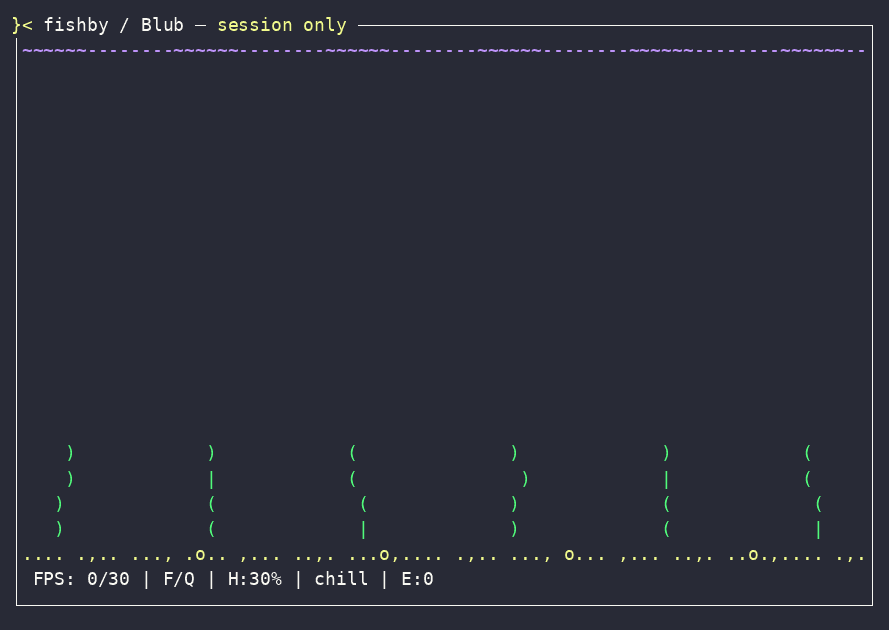

# fishby

```text
                      o
                   O
                 o
    ~ ~ ~ ~ ~ ~ ~ ~ ~ ~ ~ ~ ~
   |                         |
   |          ><(((o>        |
   |                         |
   |   (                 )   |
   |___)_________________(___|
```

**A tiny ASCII fish living in your terminal.**

No thoughts. Just blub.

[](https://github.com/ataraxea/fishby/actions/workflows/ci.yml)

fishby is a lightweight, cross-platform terminal aquarium
written in C.

No external services, no accounts, no unnecessary
complexity. Just you, your terminal, and a little fish.



## Features

- Animated ASCII fish with organic movement
- Animated bubbles, water, and aquatic plants
- Interactive feeding and food particles
- Hunger and mood simulation
- Persistent pet statistics
- Custom fish names
- Configurable frame rate
- Fixed-timestep simulation
- Adaptive terminal dimensions
- Color and monochrome modes
- Session-only mode without persistent storage
- Graceful shutdown and terminal restoration
- Native Linux and Windows builds

## Platform Support

| Platform | Architecture | Terminal backend |
|----------|--------------|------------------|
| Linux | x86_64 | ncurses |
| Windows | x86_64 | PDCurses |

Windows builds use MinGW-w64 and PDCurses.


## Installation

### Linux

Requirements:

- C11-compatible compiler
- ncurses
- Make or CMake

Arch Linux:

```sh
sudo pacman -S --needed base-devel ncurses cmake
```

Debian / Ubuntu:

```sh
sudo apt install build-essential libncurses-dev cmake
```

Clone the repository:

```sh
git clone https://github.com/ataraxea/fishby.git
cd fishby
```

Build and run:

```sh
make
./fishby
```

### Windows

Windows binaries can be downloaded from successful
[GitHub Actions builds](https://github.com/ataraxea/fishby/actions/workflows/ci.yml).

Extract the Windows build artifact and open a terminal
in the extracted directory.

Run:

```powershell
.\fishby.exe
```

Prebuilt release packages will be available once the
first stable release is published.

## Usage

Start the aquarium:

```sh
fishby
```

When running directly from the build directory, use
`./fishby` on Unix or `.\fishby.exe` on Windows.

### Controls

| Key | Action |
|-----|--------|
| F | Feed the fish |
| Q | Save and quit |
| Ctrl+C | Interrupt the application |

### Command-line options

| Option | Description |
|--------|-------------|
| `--help` | Display usage information |
| `--version` | Display version information |
| `--name NAME` | Set the fish name |
| `--fps FPS` | Set the frame rate (10-120) |
| `--no-color` | Disable terminal colors |
| `--no-save` | Disable persistent storage |

### Examples

Give your fish a name:

```sh
fishby --name Blub
```

Limit the frame rate:

```sh
fishby --fps 30
```

Run without colors:

```sh
fishby --no-color
```

Start a temporary session:

```sh
fishby --no-save
```

Combine options:

```sh
fishby --name Blub --fps 60 --no-save
```

## Pet Simulation

The fish gradually becomes hungry over time.

Feeding releases food particles into the aquarium.
The fish moves toward food and consumes it on contact.

Its mood changes depending on hunger and recent feeding.

Hunger and the total amount of consumed food are
preserved between sessions when persistent storage
is enabled.

## Persistent Storage

fishby stores pet statistics locally.

On Linux:

```text
$XDG_DATA_HOME/fishby/
```

If `XDG_DATA_HOME` is not configured:

```text
~/.local/share/fishby/
```

On Windows:

```text
%LOCALAPPDATA%\fishby\
```

The storage backend uses a versioned state format
and a portable 64-bit food counter.

A separate lock prevents multiple instances from
concurrently modifying the same persistent state.

Use `--no-save` to run without loading or writing
persistent pet statistics.

## Security and Reliability

fishby is designed to keep its attack surface small.

- No network communication
- No telemetry or external services
- Bounded state-file parsing
- State value validation
- Concurrent storage protection
- Temporary-file replacement for state updates
- Symbolic-link protection for POSIX state files
- Reparse-point checks for Windows state files
- Restrictive POSIX storage permissions
- Platform-specific compiler hardening
- AddressSanitizer and UndefinedBehaviorSanitizer
- Automated tests and static analysis

These mechanisms reduce common risks but do not
constitute a formal security audit.

## Architecture

fishby separates simulation, rendering, storage,
and platform-specific functionality.

```text
src/
  main.c                Application loop
  fish.c                Fish movement and animation
  aquarium.c            Aquarium rendering
  bubbles.c             Bubble simulation
  food.c                Food particles
  pet.c                 Hunger and mood simulation
  cli.c                 Command-line interface
  state.c               POSIX persistent storage
  state_windows.c       Windows persistent storage
  signals.c             Platform signal handling
  platform_time.c       Platform timing
  platform_terminal.c   Terminal abstraction

include/                Public module headers
tests/                  Automated tests
cmake/                  Build toolchains
.github/workflows/      Continuous integration
```

## Development

### Standard build

```sh
make
```

### Sanitizer build

```sh
make sanitize
./fishby-san
```

### Static analysis

Requires Clang and Cppcheck.

```sh
make analyze
make lint
```

### Run automated tests

```sh
make test
```

### Run all development checks

```sh
make check
```

The Makefile is intended for Linux development.

### Cross-platform CMake build

```sh
cmake -S . -B build -DCMAKE_BUILD_TYPE=Release
cmake --build build
ctest --test-dir build --output-on-failure
```

On Unix, enable sanitizers with:

```sh
cmake -S . -B build-san \
    -DCMAKE_BUILD_TYPE=Debug \
    -DFISHBY_SANITIZERS=ON

cmake --build build-san
ctest --test-dir build-san --output-on-failure
```

## Continuous Integration

GitHub Actions provides build and test workflows for:

- Linux x86_64
- Windows x86_64

The workflow includes automated tests, Linux sanitizer
builds, static analysis, and downloadable build artifacts.

## Limitations

- Requires a compatible terminal environment.
- Colors depend on the terminal palette.
- Frame rates depend on terminal performance and
  operating system scheduling.
- Windows storage checks are not identical to POSIX
  permission checks.
- Automated tests do not cover all interactive
  rendering behavior.

## Tech Stack

- C11
- ncurses / PDCurses
- POSIX API / Win32 API
- GCC / Clang / MinGW-w64
- Make / CMake
- GitHub Actions

## Contributing

Contributions, bug reports, and improvement suggestions
are welcome.

See [CONTRIBUTING.md](CONTRIBUTING.md) for development
instructions and contribution guidelines.

## Security

See [SECURITY.md](SECURITY.md) for information about
security measures, limitations, and vulnerability reporting.

## Changelog

See [CHANGELOG.md](CHANGELOG.md) for version history
and notable changes.


## License

fishby is released under the [MIT License](LICENSE).

See [THIRD_PARTY_NOTICES.md](THIRD_PARTY_NOTICES.md)
for information about third-party dependencies and
their licensing terms.


## Status

**v1.0.0 — Initial stable release.**

Available for Linux and Windows (x86_64).


Download the latest version from
[GitHub Releases](https://github.com/ataraxea/fishby/releases/latest).

---

Made for fun, not for productivity.
